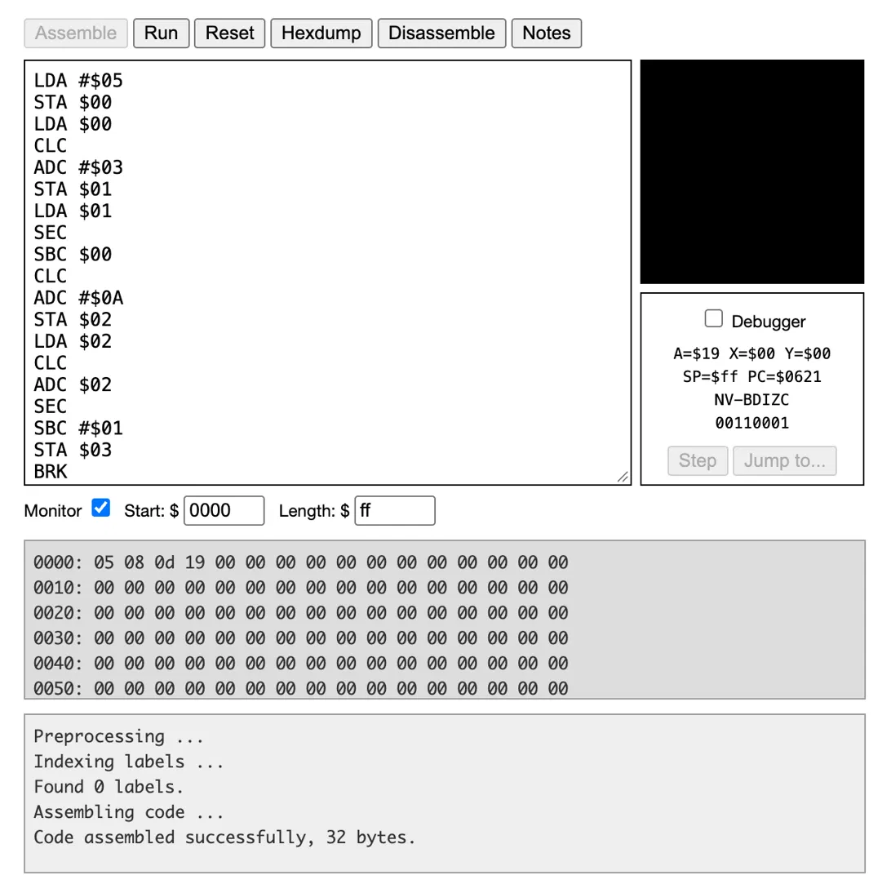

# Mini 6502 Compiler

A small compiler, written in Python, that translates a simple language of variable assignments into 6502 assembly.



## Example

Input (`example.txt`):

```
a = 5
b = a + 3
c = b - a + 10
d = c + c - 1
```

Output:

```
LDA #$05
STA $00
LDA $00
CLC
ADC #$03
STA $01
...
BRK
```

When you run it on a 6502, memory ends up as `$00 = 05`, `$01 = 08`, `$02 = 0D` and `$03 = 19` (5, 8, 13 and 25).

## Language

- Values are 8-bit (0–255) and wrap around the same way they do on real hardware. For example, `3 - 5` gives `254`.
- Operators are `+`, `-` and `*`. Multiplication happens before addition and subtraction, so `2 + 3 * 4` gives `14`.
- A variable has to be assigned before it can be used.
- Lines starting with `#` are comments.

## How it works

1. **Tokenizer:** splits each line into numbers, names and operators.
2. **Parser:** groups the tokens into terms joined by `+` or `-`, where each term is a set of factors joined by `*`. That grouping is what makes `*` happen first.
3. **Variable table:** gives each variable one byte in zero page (`$00`–`$FC`). The bytes `$FD`–`$FF` are kept as scratch space.
4. **Code generator:**
   - It loads the first term into the accumulator with `LDA`.
   - It adds the next terms with `CLC` + `ADC` and subtracts them with `SEC` + `SBC`.
   - It stores the result with `STA`.
   - The 6502 has no multiply instruction, so `*` becomes a loop that adds the multiplicand to itself `X` times (`LDX`, `ADC`, `DEX`, `BNE`).

## Run it

```
python compiler.py example.txt
```

To test the output, paste it into [Easy6502](https://skilldrick.github.io/easy6502/), click **Assemble** and then **Run**, and check the memory monitor at `$0000`.

## Tests

The tests compile each program, assemble it, run it on an emulated 6502 ([py65](https://github.com/mnaberez/py65)), and check the values that end up in memory. They also check that bad programs fail with clear error messages.

```
pip install pytest py65
pytest test_compiler.py
```

## Next steps

- Add comparisons with `if` statements, then loops.
- Add 16-bit values.
- Add output to the screen.
